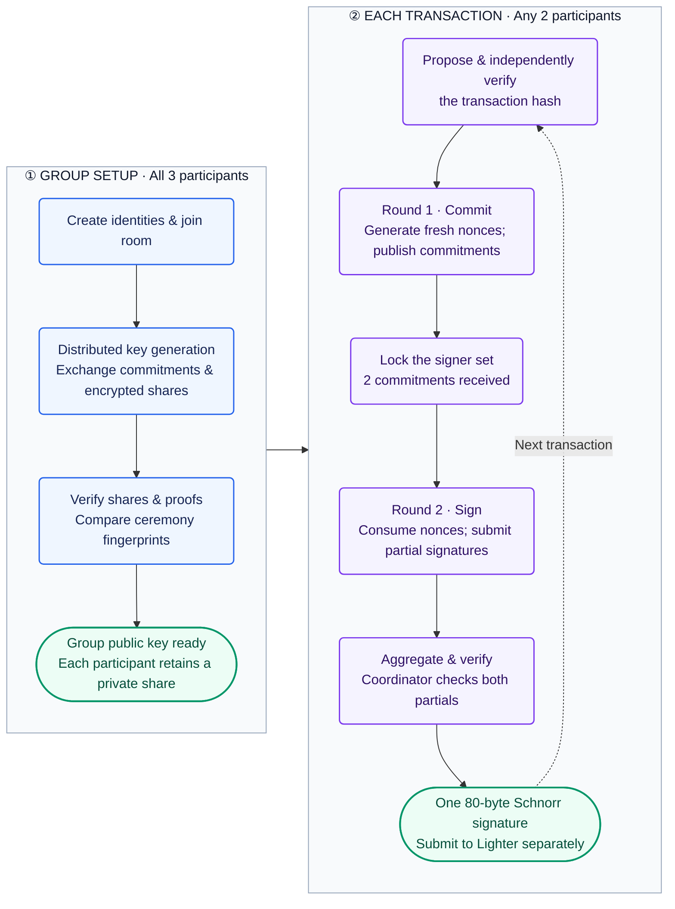

# Lighter Threshold Signatures

A **t-of-n threshold Schnorr signature ceremony** for Lighter, using ECgFp5 and the
signature format from `poseidon_crypto` / the zklighter-sdk signer. Participants
jointly generate a key and produce an ordinary SDK-compatible signature without
assembling the full private key. The coordinator stores public transcripts and
end-to-end encrypted shares in SQLite.

**Status:** security audit in progress; conclusions are pending. See the
[deployment guide](#deploy) and
[security and operating requirements](#security-and-operating-requirements).

[Workflow](#protocol-overview) · [Quick start](#build-and-run-locally) ·
[CLI](#use-the-cli) · [Browser](#use-the-browser) · [Deploy](#deploy) ·
[Key safety](#protect-identities-and-signing-state) ·
[Security](#security-and-operating-requirements) · [Development](#development-and-testing)

## Protocol overview

**Create the group once; sign together whenever needed.** In this 2-of-3 example,
all three participants join key generation. Any two can then sign a transaction.
The full private key is never assembled.



Clients verify Ethereum-signed membership statements, DKG commitments and proofs,
and their decrypted shares before computing the group public key. Signing follows
FROST's two-round structure: fresh hiding/binding nonces, transcript-bound binding
factors, and Lagrange-weighted partial signatures. The final signature is checked
with the SDK's `schnorr.Validate` verifier.

The coordinator relays public transcripts and encrypted shares. DKG, proposals,
commitments, and partial submissions use per-room authentication signatures;
joins use Ethereum signatures. Room creation, reads, and aggregation requests are
not participant-authenticated.

**Review is manual.** Compare fingerprints over a separate channel and independently
verify the transaction hash. `sign` can submit a partial immediately once the signer
set locks; it does not pause for fingerprint approval. `execute` aggregates the
signature but does not broadcast a transaction. See the [CLI walkthrough](#use-the-cli).

## Build and run locally

Prerequisites: the Go version declared in [go.mod](go.mod), Bash, and Git.
Run these commands from the repository root:

```sh
./scripts/build.sh
./dist/tsig-server -addr 127.0.0.1:9000 -db ./tsig.db
```

Open `http://127.0.0.1:9000` for the browser interface or configure the CLI below.
The REST API reference is available at `http://127.0.0.1:9000/api.html`.

The build script produces `dist/tsig-server` and `dist/tsig`. It also builds
`static/main.wasm` and copies the matching Go runtime shim before embedding the web
client in the server binary. A bare `go build .` does not generate WASM.

To build only the CLI:

```sh
go build -trimpath -o dist/tsig ./cmd/tsig
```

## Use the CLI

Build the CLI from reviewed source to avoid loading executable client code from
the coordinator. Each participant needs a separate identity and signing-state file.
Examples below use the binaries from `scripts/build.sh`.

### Create and configure an identity

```sh
./dist/tsig keygen             # creates tsig-key.json with permissions 0600
cp .env.example .env
```

Edit `.env` to select your coordinator and identity:

```dotenv
TSIG_SERVER=http://127.0.0.1:9000
TSIG_KEY_FILE=tsig-key.json
```

Use your HTTPS coordinator URL for remote access. Confirm the configured address:

```sh
./dist/tsig whoami
```

The key file contains a random 64-byte seed from which the Ethereum identity and
per-room secrets derive. To export it to a new file:

```sh
./dist/tsig export-key -o /secure/path/identity-backup.json
```

Configuration comes from environment variables and `.env`, or a file selected by
`./dist/tsig -env /path/to/config <command>`. **Values in the config file override
matching environment variables.** `TSIG_SERVER` is required for server commands.
Legacy `TSIG_SEED` is accepted, but new identities should use `TSIG_KEY_FILE`.

### Create a room and complete key generation

One participant creates the room; this example requires any two of three signers:

```sh
./dist/tsig create -t 2 -n 3
```

For a restricted roster, add `-addresses` with exactly three comma-separated,
complete Ethereum addresses from the participants' `whoami` output. The maximum
room size is eight. Share the returned five-word room code out of band.

Each participant runs the following commands with their own configured identity,
replacing `ROOM_CODE` with the actual code:

```sh
./dist/tsig join ROOM_CODE
./dist/tsig status ROOM_CODE
```

Once everyone has joined, each participant posts their DKG round:

```sh
./dist/tsig dkg ROOM_CODE
./dist/tsig status ROOM_CODE
```

Wait for all DKG submissions and the group public key. Compare the five-word
ceremony fingerprint with every participant over a separate channel. Stop if
fingerprints differ. The application displays fingerprints but does not enforce
agreement between participants.

### Propose, sign, and aggregate

Proposals contain a **40-byte Lighter transaction hash** (80 hexadecimal digits,
optionally prefixed with `0x`). Each signer must independently reconstruct the
intended transaction and check its hash; the application does not decode it.
Replace `TX_HASH` and `PROPOSAL_ID` below with actual values:

```sh
./dist/tsig propose ROOM_CODE TX_HASH
./dist/tsig pending ROOM_CODE
./dist/tsig sign ROOM_CODE PROPOSAL_ID
```

`sign` first posts a fresh nonce commitment. When enough signers have committed,
the signer set locks. Selected participants rerun `sign` if they previously saw
“waiting for more signers.” Once locked, the command can immediately submit its
partial signature; printing the proposal fingerprint is **not** a confirmation
prompt. Compare fingerprints out of band, and do not assume the program enforces
that review before signing.

After all selected signers have submitted partials:

```sh
./dist/tsig execute PROPOSAL_ID
./dist/tsig status ROOM_CODE
```

`execute` asks the coordinator to aggregate and verify the signature, then prints
the result. It does **not** submit a transaction to Lighter.

Other commands:

```sh
./dist/tsig list
./dist/tsig pending ROOM_CODE
./dist/tsig watch ROOM_CODE --allow-auto-sign
```

`watch` joins, runs DKG, and signs every proposal without transaction review.
The explicit flag opts into unattended signing; use it only for test automation.

## Use the browser

1. Open the coordinator URL, create a room with a threshold and optional address
   allowlist, and share its room link.
2. Each participant opens `/room/ROOM_CODE`, connects MetaMask, unlocks their local
   keystore with an EIP-712 signature, and approves the join statement.
3. Leave the room open for automatic DKG. When ready, compare ceremony fingerprints
   over a separate channel.
4. Create a proposal with the intended transaction hash. Review that hash
   independently before clicking **Sign**. The browser posts the partial
   automatically after the signer set locks; fingerprint agreement is not enforced.
5. Once all selected partials are available, choose **Execute** to aggregate.

The browser creates a random seed, encrypts it under the wallet unlock signature,
and stores the keystore locally. Use the room page's export/import controls for
backup or migration. The wallet alone cannot recover a lost browser keystore.

The coordinator serves the JavaScript and WASM and could replace them with code
that steals secrets or signs a different transaction. Browser nonce state is
serialized across tabs of the same browser using the Web Locks API, so two tabs
signed into the same identity cannot both consume the same nonce pair; this does
not cover two different browsers or machines signed into the same identity
concurrently — avoid that regardless. Use a separately built CLI when you cannot
trust the server delivering the browser code.

## Protect identities and signing state

- Keep identity files private and backed up offline with encryption. Anyone with
  the seed can act as that participant. Losing it loses access to that identity's
  shares; a new ceremony is needed if the group cannot meet its threshold.
- Never commit keys, keystores, databases, `.env`, or nonce journals. Default key
  and state filenames are ignored by Git; custom backup filenames may not be.
- Preserve `<key-file>.state.json`: it stores one-shot nonces and consumed-proposal
  markers. Legacy seed configurations use `<env-file>.state.json`. Never roll back
  a journal, delete it to retry signing, or use copies of one identity concurrently.
- CLI journal writes are atomic and synced. An exclusive `.state.json.lock` file
  serializes CLI signing using the same journal path. After a crash, remove only
  the stale lock once you have confirmed that no process uses that identity.
- A consumed nonce stays consumed even if submission fails. Create a new proposal
  instead of restoring old signing state. Moving a key does not make concurrent
  signing from its old location safe.

## Deploy

### Build for the target host

Build on the host using `./scripts/build.sh`, or cross-compile, for example:

```sh
GOOS=linux GOARCH=arm64 ./scripts/build.sh
```

Use `GOARCH=amd64` for an x86-64 host. The script sets the browser build to
`GOOS=js GOARCH=wasm` regardless of the server target. Transfer `dist/tsig-server`
and [deploy/tsig.service](deploy/tsig.service) to the host using your deployment
system. The old `deploy.sh` is retired and makes no remote changes.

### Install as a Linux service

The supplied unit uses systemd, a dedicated `tsig` account, and
`/var/lib/tsig/tsig.db`. On a new host, from the directory containing the build
artifacts and service template:

```sh
sudo useradd --system --user-group --home-dir /var/lib/tsig --shell /usr/sbin/nologin tsig
sudo install -d -m 0755 /opt/tsig
sudo install -m 0755 dist/tsig-server /opt/tsig/tsig-server
sudo install -m 0644 deploy/tsig.service /etc/systemd/system/tsig.service
sudo systemctl daemon-reload
sudo systemctl enable --now tsig
sudo systemctl status tsig
curl --fail http://127.0.0.1:9000/readyz
```

Skip account creation if the account already exists; adapt account-management
commands to your distribution. Systemd creates the state directory. The service
uses restrictive file permissions, restarts on failure, and shuts down on SIGTERM.
View logs with `sudo journalctl -u tsig -f`.

Run **one server process per database**: protocol serialization uses an in-process
mutex. Available server flags are `-addr` (default `127.0.0.1:9000`) and `-db`
(default `tsig.db`). Incompatible pre-FROST databases are rejected without renaming
their tables; preserve them separately and start new ceremonies in a new database.

### Configure network access

Keep the application listener on loopback and put a TLS reverse proxy in front of
it. Configure your hostname and certificate at the proxy, forward traffic to
`127.0.0.1:9000`, and set request/connection limits and access controls appropriate
to your participant group. Point clients at that HTTPS URL.

Room creation and public reads are unauthenticated. The server limits request
bodies to 64 KiB and has HTTP deadlines, but has no storage quota, retention policy,
application rate limiting, or paginated listings. Do not expose an unrestricted
instance to the Internet. Monitor disk use and service errors; avoid logging keys
or seeds. `GET /healthz` reports HTTP liveness; `GET /readyz` checks database connectivity
with a one-second deadline and returns HTTP 503 when unavailable. Neither endpoint
returns ceremony data.
TLS protects transport; it does not make server-delivered browser code trustworthy.

### Back up and upgrade

1. Stop the service: `sudo systemctl stop tsig`.
2. Back up `/var/lib/tsig` (including any SQLite sidecar files), the service
   configuration, and the previous server binary. Restrict access to backups.
3. Test restoration on an isolated instance before upgrading. Install the new
   binary at `/opt/tsig/tsig-server` while the service is stopped.
4. Run `sudo systemctl start tsig`, inspect logs, and repeat the HTTP smoke check.

Do not run different versions against one database concurrently or assume schema
changes are reversible. Server backups contain transcripts and encrypted shares;
client identity files and nonce journals require separate handling as described
[below](#protect-identities-and-signing-state).

## Security and operating requirements

**The security audit is in progress; conclusions and production readiness are
pending.** The expected deployment is an institution running its own
coordinator for its own participants — for example, a company operating one
instance internally, where everyone with access to it is a trusted employee.
Within that model, **the operator of the coordinator is trusted, and it is
assumed to serve the unmodified WASM and JavaScript client from this
repository.** Client-side verification (DKG proofs of knowledge, share
consistency, group-key recomputation, per-partial signature checks) still
protects the ceremony's correctness and catches accidental or partial
failures; it is not yet sufficient on its own to defend against an actively
malicious coordinator operator — in particular, DKG share recipients are not
yet checked against signed join statements before shares are encrypted to
them — and hardening that further is tracked as follow-up work. A coordinator
can still withhold data or interrupt progress even when trusted. Proposal
creation includes a client-chosen request nonce; the coordinator rejects a
replayed `(room, proposer, nonce)` as a duplicate rather than creating a new
proposal from it. Proposals still have no expiry. The commit and partial
endpoints have no request nonce of their own, but a replay there is naturally
idempotent (each stores at most one row per proposal and signer) rather than
duplicating anything — account for the remaining expiry gap in the surrounding
workflow.

The coordinator uses atomic DKG and signer-set updates, transactional schema
initialization, bounded JSON requests, HTTP deadlines, error redaction, and graceful
shutdown. Signing uses one-shot nonces with persisted consumption markers;
[key safety](#protect-identities-and-signing-state) explains storage and recovery.

Operational requirements are covered where they apply:

- [Deployment](#deploy): TLS, access controls, resource limits, monitoring, and backups.
- [CLI signing](#propose-sign-and-aggregate): independent hash verification and manual
  fingerprint comparison; the application does not decode transactions or enforce agreement.
- [Browser use](#use-the-browser): trust in server-delivered code and one active
  signing session per identity.

## Development and testing

The suite covers protocol round trips, malformed and oversized requests, legacy
database preservation, nonce persistence and corruption, DKG and signer-set rollback,
health probes, graceful shutdown, and HTTP status handling. The end-to-end test runs
a 3-of-4 ceremony and checks the signature with the SDK verifier.

```sh
go mod verify
go vet ./...
go test -race ./...
./scripts/build.sh
./scripts/test-e2e.sh
```

The integration script requires `curl` and port 19000 to be available. It starts a
local server with a disposable database, creates test identities, verifies the
ceremony, and removes its temporary data. Against an already running **test** server:

```sh
go run ./e2e -base http://127.0.0.1:9000
```

That command creates rooms on the target server. CI runs formatting, module
verification, static analysis, race tests, builds, and the HTTP ceremony.
The module path, `tsig-poc/*` cryptographic domains, and browser EIP-712 domain
are retained for compatibility. Do not rename them as cosmetic cleanup: they affect
key derivation, signatures, or keystore access.

Format changed Go files with `gofmt -w` before submitting a change. Include
regression tests for authentication, protocol, and persistence changes, and explain
compatibility or migration consequences. Discuss protocol changes before implementation;
successful tests do not replace independent review. See [CONTRIBUTING.md](CONTRIBUTING.md).

## Repository layout

| Path | Purpose |
| --- | --- |
| `frost/` | DKG, proofs, ECIES, signing, authentication, fingerprints, verification |
| `cmd/tsig/`, `tsigclient/` | CLI and typed HTTP client |
| `wasmclient/`, `static/` | Go WASM bridge and browser interface; `/api.html` API reference |
| `main.go` | CLI flags, embedded assets, and process signal handling |
| `internal/coordinator/` | Server lifecycle, HTTP handlers by ceremony stage, SQLite persistence and migrations |
| `e2e/` | HTTP ceremony test clients |
| `scripts/` | Build and disposable integration test scripts |
| `deploy/` | Systemd service template |
| `.github/workflows/` | Continuous integration |

## License

The repository owner's license selection is pending. The existing local `LICENSE`
names “Lighter Prover” and is preserved for owner review. Publication and any
license change require the owner's decision.
